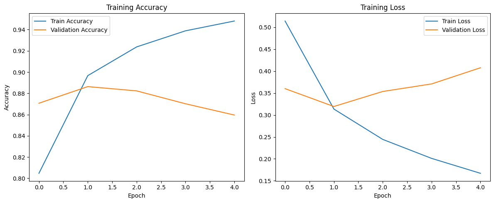
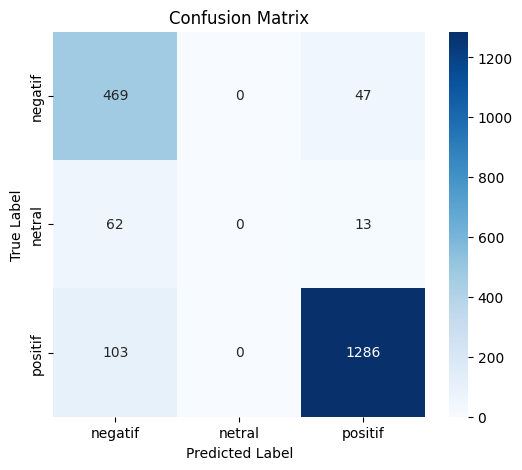

# Gojek Review Sentiment Analysis

Sentiment classification of Indonesian Google Play Store reviews using LSTM architectures.

---

## Overview

This project provides a natural language processing study on Indonesian customer reviews of the Gojek mobile application collected from the Google Play Store. The objective is to classify text feedback into three sentiment categories: `positive`, `neutral`, and `negative`.

The repository covers custom dataset collection via `google-play-scraper`, text preprocessing and tokenization, and comparative experiments across different recurrent neural network architectures and train/test splits.

---

## Model Comparison & Evaluation

Three distinct experimental schemes were trained and evaluated on unseen test sets:

| Scheme | Architecture | Train/Test Split | Test Accuracy | Macro F1-Score |
| :---: | :--- | :---: | :---: | :---: |
| 1 | LSTM (128 units) | 80/20 | 88.99% | 0.89 |
| 2 | Bidirectional LSTM (64 units) | 80/20 | 88.23% | 0.88 |
| 3 | LSTM (128 units) | 70/30 | 88.11% | 0.88 |

Scheme 1 (unidirectional LSTM with an 80/20 split) demonstrated the highest performance at 88.99% test accuracy.

### Training History (Scheme 1)

### Confusion Matrix

---

## Network Architecture

The recurrent models share the following structural components:
- Text tokenizer with vocabulary truncation and length padding
- Trainable Word Embedding layer
- LSTM or Bidirectional LSTM layer with recurrent dropout
- Dense classification layer with ReLU activation
- Softmax output layer (3 sentiment classes)
- EarlyStopping callback configured to monitor validation loss

---

## License

MIT: [LICENSE](LICENSE)
